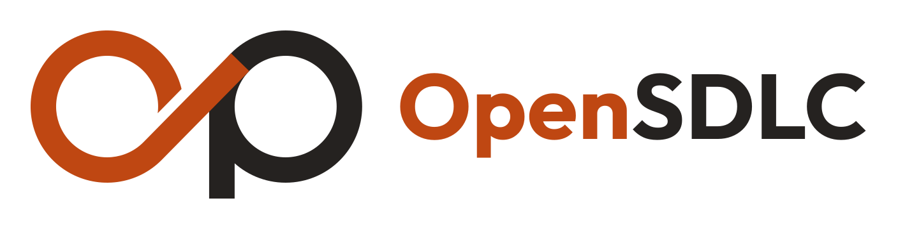

<h1>
  <picture>
    <source media="(prefers-color-scheme: dark)" srcset="brand/logo/opensdlc-horizontal-for-dark.svg">
    
  </picture>
</h1>

[](https://github.com/opensdlc-group/opensdlc/actions/workflows/test.yml)
[](https://scorecard.dev/viewer/?uri=github.com/opensdlc-group/opensdlc)
[](https://www.bestpractices.dev/projects/16515)
[](LICENSE)

An open-source AI-native SDLC. Work moves through a loop of committed artifacts (`intent.md` → `spec.md` → `plan.md` → diff → review → incident → `intent.md`), each accepted artifact starts the next stage, and every control is either deterministic code or a human gate. The artifacts, checks and approval rules are plain files and a dependency-free CLI, so they belong to no one agent. The first implementation of the agent side runs on Claude Code.

It implements the process described in Anthropic's [AI-native SDLC playbook](https://claude.com/resources/articles/the-ai-native-sdlc-playbook) as a repository template plus a Claude Code plugin. It is an independent project, not affiliated with Anthropic. [docs/playbook-map.md](docs/playbook-map.md) maps every play to the part of OpenSDLC that implements it.

**Status:** early. Every default has been measured on the project's own benchmark ([docs/evidence.md](docs/evidence.md)), but so far OpenSDLC has run only on that benchmark, not on real repositories. Until 1.0 a minor release can change how a stage behaves; [CHANGELOG.md](CHANGELOG.md) says what changed.

## What you get

**A Claude Code plugin** (`plugin/`):

- Stage skills: `intent`, `spec`, `plan`, `build`, `repro`, `review`, `shepherd`, `incident`, `learn`, `adopt`
- Shared practice skills the stages use: `interview`, `domain` (`GLOSSARY.md` and ADRs), `test-first`, `diagnose`
- Judgment skills, run in a session of their own so work is never judged by the context that wrote it: `gate` (an adversarial confidence gate after every headless spec, plan and build) and `verify` (runs the proof and the app; the gate uses it on a build before judging)
- Agents: `verifier` (the `verify` skill as a fresh-context subagent, for interactive use), `simplifier`, `researcher`
- Hooks, configured per repo in `.opensdlc/config.json`:
  - deny writes to protected paths, `.env` files and frozen tests, whether through file tools or shell commands, with the reason and the route to approval
  - deny secrets in file edits
  - per-environment autonomy: development runs freely, staging asks, production needs a release authorization
  - block "done" until the verify commands have passed since the last code edit
  - run your formatter after every edit and show failures to Claude

**A repository template** (`plugin/template/`), installed with `/opensdlc:adopt`:

- `AGENTS.md` (with a `CLAUDE.md` that imports it), `REVIEW.md`, `.claude/settings.json`, `CODEOWNERS`
- `changes/` for the artifact chain, `knowledge/` for owned policies, architecture and domain documents, `evals/cases/` for agent regression tests
- A dependency-free Python CLI (`.opensdlc/cli`) that validates and pins artifacts to their upstream and their knowledge, decides which stage is due, enforces approvals and plan match, evaluates control bands, runs evals against main's baseline, publishes reviews, and collects all 35 of the playbook's leading and lagging indicators
- GitHub workflows:

| Workflow | Trigger | Does |
| :- | :- | :- |
| `opensdlc-checks` | Every PR | Validates artifacts and knowledge, and holds code PRs to their plan's "Files that change", using the base branch's rules |
| `opensdlc-approvals` | Every PR and review | Passes only when each artifact the PR accepts has its required approvals on the latest commit |
| `opensdlc-intake` | Issue labelled `intent` | Drafts an intent from the ticket and opens it as a PR linked back to the issue |
| `opensdlc-advance` | Push to main touching `changes/` | Runs the next stage for each newly accepted artifact, then the confidence gate in a session of its own (which verifies a build before it judges), and opens the result as a PR |
| `opensdlc-review` | Every PR | Standards, Spec and Security axes against `REVIEW.md`, the change's artifacts and its policies; inline findings; tally with suggested `AGENTS.md` rules for repeats |
| `opensdlc-claude` | `@claude` from a member | Fix loop on review comments |
| `opensdlc-evals` | Agent configuration changes; nightly | Runs every case several times and fails on a drop against main's last run |
| `opensdlc-security` | Every PR; weekly | Secret, dependency and static-analysis scans |
| `opensdlc-ci-triage` | A failed CI run on a PR | Diagnosis posted as a PR comment |
| `opensdlc-monitor` | Hourly | Deterministic band detection; on breach, Claude diagnoses into a draft `intent.md` PR and may trigger a pre-approved runbook |
| `opensdlc-rollback-drill` | Weekly | Rehearses `rollback-deploy` against staging |
| `opensdlc-knowledge-sync` | Weekly | Syncs shared organization knowledge into `knowledge/org/` as a PR |
| `opensdlc-review-tuning` | Monthly | Rates the reviewer from 👍/👎 reactions and suggests `REVIEW.md` changes |
| `opensdlc-metrics` | Weekly | Collects every indicator against the previous window and the pre-adoption baseline |

**A claude.ai skill** (`claude-ai/opensdlc-intent/`) so product owners and other non-engineers can capture an intent in claude.ai and hand it over through the GitHub connector or as a download.

## How agents run in CI

Every agent job is read-only. It checks out without credentials, runs Claude Code inside its OS sandbox with the API key and GitHub tokens hidden from shell commands and network limited to package registries and GitHub, and uploads its work as a patch. A separate job checks the patch against the untouched checkout before applying it: it refuses anything that leaves the stage's scope or change folder, touches what Claude Code, git or the pipeline act on (`.github/`, `.opensdlc/`, `.claude/`, `.mcp.json`, `CLAUDE.md`, `.gitattributes`, knowledge, eval cases), or adds a symlink. Only then does it open the PR. [docs/security-model.md](docs/security-model.md) has the details and what is out of scope.

Each job is offered only the tools its permissions name, and its Bash runs only the commands those permissions name, even inside the sandbox. Build runs on Haiku; every other stage and every judge runs on your default model, so a stronger model decides whether the work goes through. [docs/evidence.md](docs/evidence.md) shows what each of these choices did on the benchmark.

## Measure it

Every play in the playbook comes with a leading and a lagging indicator. `python3 -m opensdlc metrics` collects all 35 from git history, pull requests, reviews, CI runs, deployments, tickets and incidents, plus your OpenTelemetry and Claude Security exports if you point it at them. Set `metrics.adoptedAt` and the report compares each window with the period before adoption. Where a source is not configured, the report says what it needs instead of guessing. [docs/indicators.md](docs/indicators.md) lists every indicator and where its data comes from.

## Benchmark it

`bench/` builds the same product through OpenSDLC again and again: a todo list in seven tickets, two of which only a person can settle, as a CLI, a library, an HTTP API and a web app. Hidden acceptance checks score each build. Run it before and after changing a skill, template or setting, and compare the two: the comparison gives every difference a 95% margin, so you can tell an improvement from noise. [bench/README.md](bench/README.md) explains how it works and how to add your own products, and [docs/evidence.md](docs/evidence.md) records what earlier changes did.

## Install

In Claude Code:

```
/plugin marketplace add opensdlc-group/opensdlc
/plugin install opensdlc@opensdlc
```

Then, in the repository you want to run this way:

```
/opensdlc:adopt
```

`adopt` copies the template without overwriting anything, tailors `AGENTS.md` and `.opensdlc/config.json` to the codebase, and walks you through [the setup checklist](plugin/skills/adopt/checklist.md): secrets, environments, branch protection, and the order to switch stages on.

CI never loads whatever the marketplace holds today. Every workflow checks out the OpenSDLC repository at the tag or commit `plugin` names in `.opensdlc/config.json`, so an upgrade is a PR the eval suite runs on, and every PR and commit the pipeline opens records the version that wrote it.

## Principles

- **The agent acts up to the gate and never past it.** Everything an agent writes arrives as a PR. Acceptance is an approved merge by the people the rules name, and the agent that wrote a change can never approve it.
- **Detection is deterministic.** Hooks, artifact checks, approvals, plan match and control bands are plain code with tests. Claude is called for judgment, after a rule has fired.
- **Every stage leaves an artifact.** The commit history is the audit trail: who asked for what, what knowledge it was built on, what the agent produced, who approved it.
- **Turn it on in order.** Review and guardrails first, then the artifact chain, then evals, then automation. Autonomy (`autoRisk`, `propose` tiers) comes last.

## Limits worth knowing

- Shell write detection parses commands; it cannot see inside a script the agent runs. The OS sandbox in CI and in [docs/managed-settings.example.json](docs/managed-settings.example.json) is the layer that stops those.
- Environment gates match command and tool patterns. Treat them as a guardrail on top of GitHub environment protection and short-lived credentials, not a replacement.
- `@claude` is the one agent with write access, because it pushes fixes to the PR it was asked about. Only repository members can invoke it.
- `OPENSDLC_PR_TOKEN` is required. PRs opened with the default `GITHUB_TOKEN` would not trigger the checks they need before they can merge.

## Getting help and contributing

- Questions about adopting or running OpenSDLC: [Discussions](https://github.com/opensdlc-group/opensdlc/discussions).
- Bugs and proposals: [issues](https://github.com/opensdlc-group/opensdlc/issues).
- Security problems: privately, as [SECURITY.md](SECURITY.md) describes.
- Changes: [CONTRIBUTING.md](CONTRIBUTING.md) explains how to set up, test, and show evidence for a change. Everyone taking part follows the [Code of Conduct](CODE_OF_CONDUCT.md).
- The logo, icon and words to describe OpenSDLC: [brand/](brand/README.md).

## License

[Apache 2.0](LICENSE). OpenSDLC has no plugin dependencies.

## Acknowledgments

The practice skills draw on ideas popularized in [Matt Pocock's skills](https://github.com/mattpocock/skills): interviewing as a tree of decisions asked a round at a time, a shared glossary with sparing ADRs, specs written as user stories with explicit testing decisions, tracer-bullet slices, and reviewing standards and spec on separate axes. OpenSDLC's skills are written independently.
