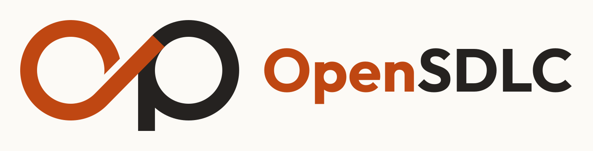
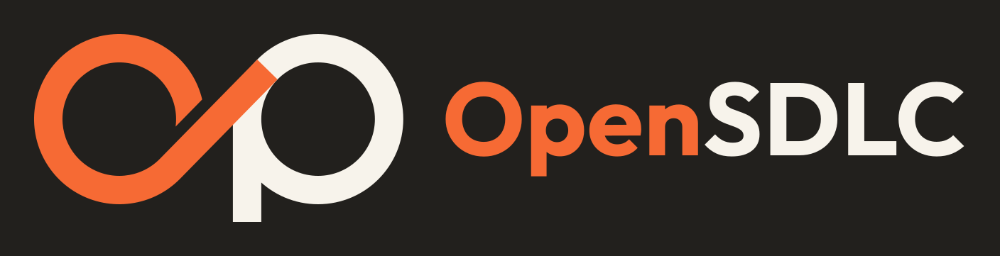
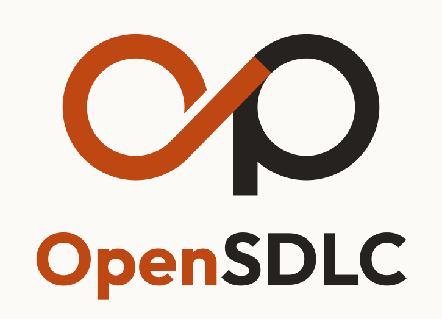
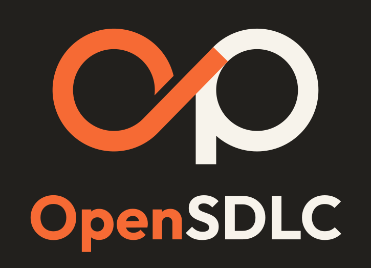
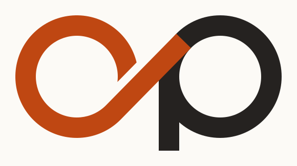
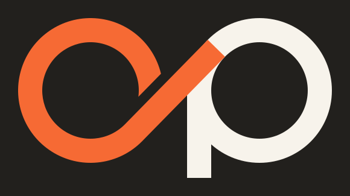

# OpenSDLC brand

Logos, icons, the social preview and the words to describe OpenSDLC. Every file is ready to use as it is.

## Logo

The mark is an "op" drawn as one loop, the way work in OpenSDLC runs from intent back to intent. Use the horizontal logo by default, the stacked one where space is square, and the mark alone where the name already appears nearby.

| | On light backgrounds | On dark backgrounds |
| :- | :- | :- |
| Horizontal |  |  |
| Stacked |  |  |
| Mark |  |  |

Each logo comes in four files in [logo/](logo/):

- `-for-light.svg` and `-for-dark.svg` have a transparent background, for pages and documents in that theme.
- `-light-background.svg` and `-dark-background.svg` carry their own background, for places that don't handle transparency well, such as slides and email.

Keep clear space around a logo at least as wide as the loop's line, and don't use the mark smaller than 24 px wide. Use the files as they are: don't recolour, stretch, rotate or outline them, add effects, or set "OpenSDLC" in another typeface.

## Icon

[icon/opensdlc-favicon.svg](icon/opensdlc-favicon.svg) is the mark on a rounded tile, made to stay legible at 16 px. The PNGs are exports of it: 16, 32 and 48 px (and `favicon.ico` holding all three) for browsers, 180 px for Apple touch icons, 192 px for web app manifests, and 512 px for avatars such as a GitHub organization's.

## Social preview

[social/opensdlc-social-preview.png](social/opensdlc-social-preview.png) is the 1280 × 640 card that shows when someone shares the repository. Upload it in the repository's Settings › General › Social preview. Edit [the SVG](social/opensdlc-social-preview.svg) and export it again to change it.

## Colour

| Name | Hex | Use |
| :- | :- | :- |
| Ink | `#252220` | The mark and wordmark on light backgrounds; body text |
| Paper | `#FCFAF6` | Light backgrounds |
| Ember | `#BF4712` | The accent on light backgrounds |
| Night | `#22201D` | Dark backgrounds and the icon tile |
| Cream | `#F7F3EB` | The mark and wordmark on dark backgrounds |
| Flame | `#F66A34` | The accent on dark backgrounds |

Ember on Paper and Flame on Night both pass WCAG AA for text, at 4.9:1 and 5.4:1. Use Ember only on light backgrounds and Flame only on dark ones.

## Describing OpenSDLC

Write the name as one word, **OpenSDLC**, with "Open" and "SDLC" capitalised as shown.

**One line**

> An open-source AI-native SDLC: committed artifacts, deterministic gates and human approvals. First implementation on Claude Code.

**Short**

> OpenSDLC is an open-source implementation of Anthropic's AI-native SDLC playbook. Work moves through committed artifacts, from intent to spec, plan, build, review and back, with every control either deterministic code or a human gate.

**Long**

> OpenSDLC is an open-source implementation of Anthropic's AI-native SDLC playbook: a repository template whose artifacts, checks and approval rules belong to no one agent, and a Claude Code plugin as the first agent implementation. Work moves through a loop of committed artifacts: an intent becomes a spec, a plan, a reviewed pull request and, when something breaks, an incident that starts the next intent. Agents draft each stage in a read-only sandbox; deterministic checks and the people the approval rules name decide what goes through. It measures all 35 of the playbook's indicators, and every default has been measured on its own benchmark. OpenSDLC is independent of Anthropic.

## Using the name and logo

The [Apache 2.0 licence](../LICENSE) covers OpenSDLC's code and these files, but, as its section 6 says, grants no rights in the OpenSDLC name or logo. You're welcome to use them unchanged to refer to OpenSDLC, for example in an article, a talk or a list of tools you use. Don't use them in a way that suggests the project endorses you, or to name a fork or a product of your own.
